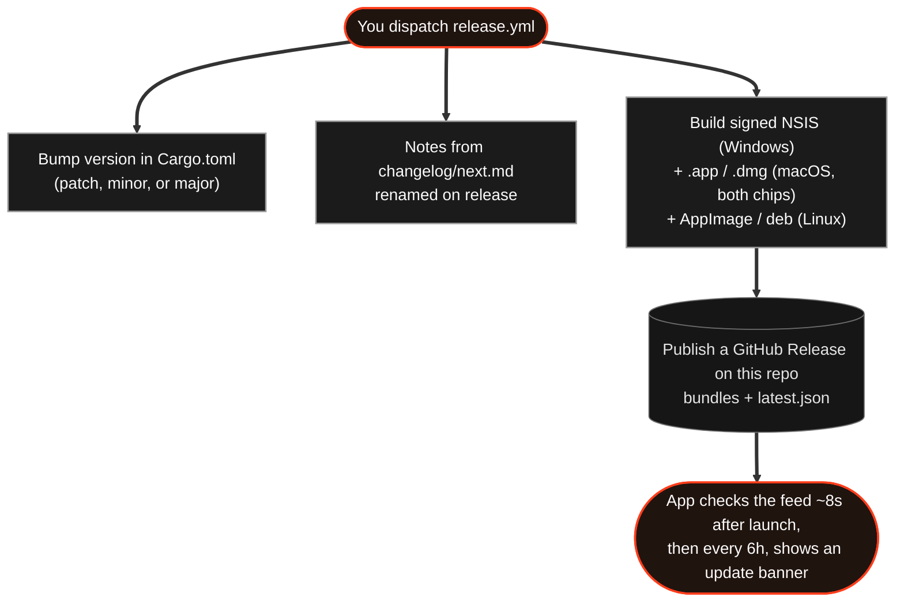

# Releasing RoverTools' Orange Copy Paste

**Owns:** shipping. The release workflow, the two update channels, the signing key, the
version-of-record, and the smoke test. Read before touching
`.github/workflows/release.yml`.
**Not here:** what the app does; and the *content* of the release notes, which lives in
[`changelog/`](../changelog/) (staged in `changelog/next.md`). This file is about
getting builds to users.

Shipping a release is one workflow run. Everything else - version number, release
notes, the update feed, the signed bundles - is derived from that.

```bash
gh workflow run release.yml
```

That is a patch release. For a feature release, `-f bump=minor`; for a breaking one or
the move to 1.0, `-f bump=major`. Or click **Run workflow** on [`.github/workflows/release.yml`](../.github/workflows/release.yml) in
the Actions tab and pick from the dropdown.

The workflow checks its own prerequisites first and stops in the first few seconds
with a message telling you what to fix, so a misconfigured release fails before it
spends a build rather than after.

**Or from Claude Code:** `/create-rovertools-orange-copy-paste-release`
([`.claude/skills/.../SKILL.md`](../.claude/skills/create-rovertools-orange-copy-paste-release/SKILL.md)).
It asks for the bump, the channel and the mode on every call, and assumes none of them.
It shows the version and the notes about to ship, dispatches only after an explicit yes,
then verifies both channels. Arguments pre-answer whatever you already know:
`/create-rovertools-orange-copy-paste-release minor beta`, or `preview` to see what the next
release would contain without dispatching anything.

---

## 1. How it fits together



Releases are published as GitHub Releases on this repo. The repo is public, so the
updater fetches the feed over plain HTTPS with no credentials - there is no separate
releases repo, and no token is shipped inside the app.

Nothing here touches the sync backend.

---

## 2. One-time setup

The workflow will tell you if any of it is missing.

### 2.1 Signing keypair

```bash
cd orange-copy-paste-clipboard-app-rust && bun tauri signer generate -w ~/.tauri/rovertools-updater.key
```

Put the **public** key in `src-tauri/tauri.conf.json` under `plugins.updater.pubkey`,
replacing `REPLACE_ME_WITH_TAURI_SIGNER_PUBLIC_KEY`, and commit it.

> **Back the private key and its password up outside CI, before the first release.**
> Every installed copy only trusts bundles signed by it. Lose it and the update
> channel is dead. A new public key means a new build, and users can only get that
> build by installing it by hand, which is the friction the updater exists to remove.

### 2.2 Two secrets, in the `release` environment

In the repo, go to Settings, then Environments, then `release`, and add these as
environment secrets. The environment only admits runs from `main`, so a workflow edited
on a branch cannot read them. Repo-level secrets with the same names also work, but any
workflow can read those.

| Secret | What it is |
|---|---|
| `TAURI_SIGNING_PRIVATE_KEY` | Contents of the private key file |
| `TAURI_SIGNING_PRIVATE_KEY_PASSWORD` | The password you set when generating it |

The release publishes to this same repo, so the workflow's built-in `GITHUB_TOKEN`
handles it; no personal access token needed.

### 2.3 Optional: Apple signing and notarization

The minisign key above is what the updater trusts, on every platform. Apple's own
signature is a separate thing: it is what Gatekeeper checks when a Mac user opens a
downloaded `.dmg`. Without it the macOS bundles still build, still carry a minisign
signature and still self-update; the one cost is that a *downloaded* copy is refused as
"damaged" or "cannot be checked for malicious software" until the user clears the
quarantine flag (the install page on the website tells them how). In-app updates do
not hit this: the updater downloads the archive itself, so there is no quarantine flag.

To sign and notarize, add these to the same `release` environment. The workflow warns
at its first step when they are missing or incomplete, and does not fail.

| Secret | What it is |
|---|---|
| `APPLE_CERTIFICATE` | The Developer ID Application certificate, exported from Keychain as `.p12` and base64-encoded (`base64 -i cert.p12 \| pbcopy`) |
| `APPLE_CERTIFICATE_PASSWORD` | The password set on export |
| `APPLE_SIGNING_IDENTITY` | The certificate's name, `Developer ID Application: <name> (<team id>)` |
| `APPLE_ID` | The Apple account the certificate belongs to |
| `APPLE_PASSWORD` | An app-specific password for that account (not the account password) |
| `APPLE_TEAM_ID` | The ten-character team id |

The first three sign; all six notarize. Tauri's bundler reads them from the
environment and does both during `tauri build`, so there is no separate step to
maintain. A Developer ID certificate needs a paid Apple Developer membership.

Only the account named in `RELEASER` at the top of the workflow can start a release.
Anyone else's run stops at its first step.

**No baseline tag is required.** The first release's notes are "First release".
Nobody updates *to* a first release; they install it.

---

## 3. Versioning

You choose the bump at dispatch. Nothing is inferred from commit messages.

| Bump | `1.1.1` becomes | When |
|---|---|---|
| `patch` | `1.1.2` | Bug fixes, tweaks |
| `minor` | `1.2.0` | New features |
| `major` | `2.0.0` | Breaking changes - or `0.9.x` -> `1.0.0`, committing to stability |

A bump zeroes everything to its right, so there is no way to reach a version like
`2.1.1` directly from `1.1.1`. If you ever need an exact version, set its predecessor by
hand (`cargo set-version 2.1.0` in `src-tauri`, committed and pushed) and then release a
`patch`.

A major bump is not special to the updater - it compares semver and offers anything
higher, so `1.1.1` -> `2.0.0` reaches users through the same banner as a patch.

`src-tauri/Cargo.toml` is the single source of truth; `tauri.conf.json` has no
`version` field on purpose (Tauri falls back to Cargo.toml) and `package.json`'s copy
is cosmetic, kept in step by the workflow. Only plain `vX.Y.Z` tags count as releases -
the `v0.1.0-build.N` tags from [`build-linux.yml`](../.github/workflows/build-linux.yml)
are throwaway CI builds and are ignored.

## 4. Release notes

Notes live in [`changelog/`](../changelog/): one file per shipped release, plus
`changelog/next.md`, the notes staged for the release you have not cut yet. The
convention lives in [`changelog/README.md`](../changelog/README.md).

### Lifecycle of `next.md`

1. You write `next.md` *before* dispatching.
2. The workflow reads it as the very first step and publishes it as the notes.
3. It renames the file to `changelog/<version>-<bump>-<channel>.md` (e.g.
   `0.2.0-minor-stable.md`, `0.1.14-patch-beta.md`) and opens a fresh `next.md`.

The filename states the version, bump and channel, all resolved at dispatch and none
guessed, so the directory reads at a glance like the run-name does.

A promoted beta keeps its `-beta` filename: the name records how it was first cut.
Rename it (`git mv changelog/<v>-<bump>-beta.md ...-stable.md`) if you want the directory
to track the current channel.

### Writing the notes

Author `next.md` with `/update-changelog`, or edit it by hand from the empty skeleton,
[`changelog/TEMPLATE.md`](../changelog/TEMPLATE.md). The skill reads the commits since
the last release, keeps the user-facing ones and writes them as a lead sentence plus
sections in the app's voice:

| Commit type | Section |
|---|---|
| `feat` | New |
| `perf` and refinements | Improved |
| `fix`, `revert` | Fixed |
| internal types | nothing |

These lines are **user-facing copy**:

- the app's "What's new" panel renders the lead sentence and the New/Improved/Fixed
  sections;
- the GitHub release body renders the same text as markdown;
- the No-AI-Slop rules in `CLAUDE.md` apply.

Internal work (backend and MCP plumbing, refactors, CI, docs, dependency bumps) goes
under a **`### Internal`** section instead. It is kept in the release file for the
record, but the workflow **drops it before publishing**, so it never reaches users.
Nothing is lost and the "What's new" panel stays about the app. `### Internal` does not
count toward the emptiness check below.

### The emptiness check

**An empty `next.md` fails a real release**, in the first few seconds, before anything
is built. The enforcement is deliberate, so you cannot ship a version with no notes.
Two exceptions:

- the very first release (no prior tag) publishes "First release.";
- a dry run substitutes a placeholder so the rehearsal can still exercise the build.

A change you want users to see has to reach `changelog/next.md`; one that stays out of
it reaches nobody.

### Where the notes also appear

Both of these are generated; `changelog/` stays the one home you edit.

- **GitHub Releases.** Each shipped release's notes render on this repo's Releases
  page, from the same body the workflow publishes, so someone browsing the releases
  reads what the app shows.
- **`CHANGELOG.md`.** The workflow rebuilds a browsable
  [`CHANGELOG.md`](../CHANGELOG.md) at the repo root from the `changelog/` files (via
  [`.github/scripts/gen-changelog.sh`](../.github/scripts/gen-changelog.sh)) and commits
  it with the release.

---

## 5. Beta releases

```bash
gh workflow run release.yml -f bump=minor -f prerelease=true
```

There are **two channels**, and anyone can opt in from Settings -> Updates -> *Get beta
versions*. Beta subscribers are offered betas **and** every normal release; stable
users are only ever offered normal releases.

| | Feed the app asks | Serves |
|---|---|---|
| Stable (default) | `releases/latest/download/latest.json` | Newest non-prerelease |
| Beta | `raw.githubusercontent.com/.../HEAD/beta.json` | Newest release of **either** kind |

Two different mechanisms because each is the simplest thing that works for its job.
Stable rides on GitHub's own `latest` resolution, which needs no maintenance and makes
promotion a one-line edit. Beta needs a pointer that *can* name a prerelease, and no
GitHub URL does that - so the workflow rewrites `beta.json` on **every** publish. That
"every" is what gives beta subscribers stable releases too.

`beta.json` is a committed file rather than a release asset on some fixed tag: a
mutable pointer *release* would either hijack `latest` or have to be excluded from
pruning by hand.

Promoting a beta to everyone, once you are happy with it:

```bash
gh release edit v0.3.0 --repo NotRover/RoverTools-Orange-Copy-Paste-App --prerelease=false --latest
```

An edit of the same bundles, not another build - so stable users receive exactly what
testers approved. Beta subscribers already have it and see nothing new, which is
correct.

Two things to know:

- **The version number is spent either way.** The bump and tag land on `main`
  regardless, so a beta that fails testing means the next attempt is the following
  patch.
- **Leaving the beta channel does not downgrade anyone.** The updater only moves
  forward. Someone on a beta stays there until a stable release passes it.

---

## 6. What can and cannot self-update

| Bundle | Self-updates | Why |
|---|---|---|
| NSIS (`.exe`) | **Yes** | The installer reruns and replaces the app in place |
| AppImage | **Yes** | A single file the updater can swap |
| `.app.tar.gz` (macOS) | **Yes** | The updater unpacks it over the installed `.app`; one per chip |
| `.deb` | No | Owned by the package manager; published for manual install only |
| `.dmg` (macOS) | No | The manual install; the updater uses the archive above instead |

The release builds no `.rpm` (the Linux build matrix entry lists only `appimage,deb`),
though a local `tauri build` still makes one. `.deb` and `.dmg` never appear in
`latest.json` - offering an update the client cannot install is worse than offering
none. The macOS bundles are built on the Apple-silicon runner for both chips; the Intel
one is a cross-compile, which is why the matrix names an explicit `--target` for them.

---

## 7. Safety rails

The workflow fails rather than shipping something broken:

- **Prerequisites** - placeholder pubkey or a missing signing secret. Checked before
  building.
- **Non-semver version** -> refused. The updater compares semver, so an unparseable
  version would publish and then never be offered.
- **A missing `.sig`** for an updatable bundle -> refused. Unsigned bundles build fine
  and are then rejected by every client: invisible until users are stuck.
- **Feed verification** -> after publishing, fetches `latest.json` through the same URL
  the app uses and range-requests every bundle URL it advertises.
- **Channel correctness** -> every run confirms `beta.json` names the release it
  published. A beta run also confirms the *stable* feed is **not** serving it. A beta leaking to everyone is silent otherwise.

Every release is kept - the workflow never deletes an old one, so the published history
stays complete.

Use `-f dry_run=true` to build and verify without publishing. Worth doing after editing
the workflow itself; not needed for an ordinary release.

### 7.2 One platform failing does not sink the release

The build jobs run independently (`fail-fast: false`) and `publish` runs as long as
`prepare` succeeded. A release with one failed build is still published with the bundles
that built: `latest.json` lists only those, the run summary and the release body name the
missing platform, and an installed app on that platform sees no update rather than an
error (the updater treats an absent platform key as nothing to offer).

The version is spent either way, because the bump and tag land on `main` before the
builds start. That is why the missing platform is added to the *same* release rather than
to the next version: see the retry below.

### 7.3 Retrying a release

A retry rebuilds some or all platforms from the current `main` and adds them to an
existing release, without a bump, notes or commit:

```bash
gh workflow run release.yml -f retry_tag=v0.5.2 -f platforms=linux
```

What it does:

- Checks the release exists and takes its version from the tag; the notes are read back
  from the release's own `latest.json` (its body if that file is missing), so
  `changelog/next.md` is not touched.
- Builds the chosen platforms (`all`, `windows`, `linux` or `macos`) from the commit the
  run checks out: `main`, with whatever fix landed after the tag. The tag stays on the
  original commit, and the release body gets a line saying which bundles were rebuilt and
  from which commit.
- Uploads the new bundles to the release, replacing same-named assets, and rebuilds
  `latest.json` from everything the release then holds.
- Updates `beta.json` only when this version is the newest, so retrying an old release
  cannot roll the beta channel back. It also leaves the release's latest/prerelease flag
  as it was.

A retry can also replace a bundle that did build, for the same reason: `platforms=all`
on a release that already has everything rebuilds all four and overwrites them. The
`platforms` input works on a normal release too, but a release that leaves platforms out
on purpose still ends up partial for those users until a retry fills it in.

### 7.1 Asset names have no spaces, deliberately

Tauri names bundles after `productName` - "Orange Copy Paste" - and GitHub rewrites
spaces in uploaded asset names to dots, which would break every URL in `latest.json`.
The workflow renames bundles to a `RoverTools_<version>_...` prefix and builds the URLs
from the renamed files.

---

## 8. Things worth knowing

Install and update behavior that is by design, grouped by platform.

### Windows

- **The first install warns.** The bundles have a minisign signature, not an
  Authenticode one, so SmartScreen shows "unrecognized app" (*More info*, then *Run
  anyway*).
  - The workflow appends a note saying so to every GitHub release body, but not to
    `latest.json`. SmartScreen keys off the Mark of the Web, which browsers attach to
    downloads and the updater doesn't, so in-app updates never trigger it.
  - Removing the warning needs a paid Authenticode code-signing certificate. None is set up today.
- **Installs are per-user** (`nsis.installMode: currentUser`). This keeps the install
  path stable across versions and avoids a UAC prompt on every update.

### macOS

- **Two downloads, one per chip.** `aarch64` for Apple silicon, `x64` for Intel. The
  updater keys on `darwin-aarch64` / `darwin-x86_64` in `latest.json`, so an install
  only ever sees updates for its own chip.
- **An unsigned build is refused by Gatekeeper on download.** See section 2.3 for what
  the Apple secrets change. Until they are set, the release body tells Mac users what
  to expect and the website's install page has the one-line fix.
- **The app asks for Accessibility on first launch.** Pasting from the popup posts a
  Cmd+V into the app you came from, which macOS only allows for apps the user has
  listed under Privacy & Security > Accessibility. The system prompt appears at first
  launch; until it is granted the app captures and shows popups as usual and leaves the
  Cmd+V to the user.
- **Install means the app restarts.** The updater unpacks the archive over the running
  `.app` and relaunches it, so the same second confirmation as everywhere else applies.

### All platforms

- **Updates are disabled in debug builds.** A dev build reports the Cargo.toml version,
  so it would see any release as an upgrade and install over `target/debug`. That
  replaces a build that loads from `devUrl` with one that doesn't. `updater.rs` refuses instead.
- **"Run on startup" survives an update.** An update reinstalls rather than patches, so
  the recorded path can name a replaced executable. When the setting is on, the app
  rewrites the entry from its own location at every launch (`reconcile_autostart`).
- **Install ends the process.** On Windows the installer takes over and the app exits
  mid-call; on Linux the AppImage is replaced and the app restarts itself. That is why
  installing sits behind a second confirmation rather than following the download:
  nobody should lose their window to a background download finishing.

---

## 9. Smoke test before trusting it

The updater itself can only be checked with two releases:

1. Release once. Install it from the published `.exe` (or `.dmg`, or AppImage) - not a
   local `tauri build`, which is unsigned and would not test the signing key.
2. Release again.
3. Launch the older install. Within ~8 seconds the banner should appear (a
   running app re-checks every 6 hours, so restarting is the fast way to see it).
4. Download -> progress -> **Restart & install** -> the app comes back on the new version.
5. With "Run on startup" on, confirm it is still on and pointing at the new executable.

Related: release notes are written in [`changelog/`](../changelog/README.md), and what the
updater does inside the app is in the app's
[`docs/architecture.md`](../orange-copy-paste-clipboard-app-rust/docs/architecture.md).
